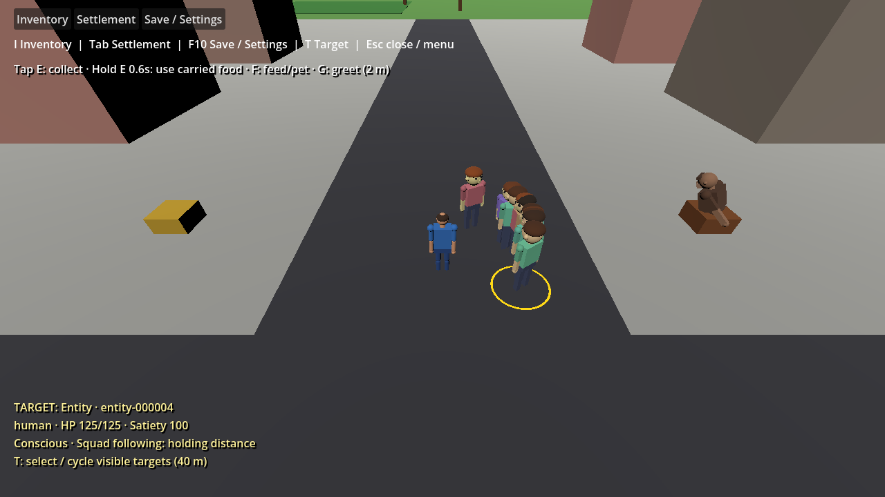

# Follow spacing repair (#395)

Follow keeps a comfortable 2 m horizontal separation from the live player. An arriving follower holds position; pursuit resumes only beyond 3 m. A member already within the 3 m holding band waits where it is. The 1 cm arrival tolerance avoids floating-point boundary churn; current human capsules total at most 0.82 m, so the 2 m boundary leaves ample collision clearance even for the widest player profile.

The existing squad order and navigation services own this behavior. Every active follow step is clipped against the live player boundary **before** moving the NPC collider. The complete segment is checked, so a large step whose endpoint is beyond the player cannot tunnel through them. A follower approached inside the boundary stops rather than stepping inward or snapping away. Main synchronizes the player into World before navigation, including each bounded 4x tick batch. Intermediate navigation corners retain a small tolerance even though follow arrival has a larger radius.

Move-to still uses 0.5 m arrival tolerance. Stop, hunger preemption, unavailable players/members, unreachable-path waiting and load/reset cancellation retain the existing contracts. Follow orders remain transient; membership remains durable under schema 10. Greeting attention retains its independent 2 m cutoff and task override rules in [INTERACTION_REPAIR.md](INTERACTION_REPAIR.md).

## Validation

- Pinned .NET restore, Release solution build and Debug game build passed. All **570** domain tests passed, including stop/resume boundaries, no request churn, crossing-segment clipping, stale player targets, large steps, inside-boundary holding, invalid positions, failed-path recovery and removed-player cancellation.
- Godot `--validate-follow-spacing` passed headless and rendered with real navigation and **player physics enabled**. One follower and then all ten held outside 2 m; a stationary player drifted less than 0.01 m over 20 simulation seconds. Approaching a follower with an active stale path did not move its collider. Resumed pursuit, stable holding and the actual 4x clock path passed.
- Godot `--validate-squad`, `--validate-first-game`, `--validate-gameplay-actions`, `--validate-menus` and `--validate-schedules` passed headless. Existing squad/save-load fixtures now expect the follow holding band instead of arrival at the player's center. `git diff --check` passed.
- NU1900 remains because NuGet vulnerability metadata is unavailable in this environment. It was not suppressed; builds had no C# diagnostics. No separate formatting/lint/packaging check is configured for this slice.

Reproduce with the pinned Godot executable: `--path game --headless -- --validate-follow-spacing`; omit `--headless` to render and refresh the evidence below. No player save/settings files are written by this scenario.

This is player clearance for the current squad, not a full formation or inter-NPC avoidance system. Followers can still bunch together; navigation/collision changes for future creature-follow commands or larger bodies should extend the same boundary rather than introducing a parallel movement system.
