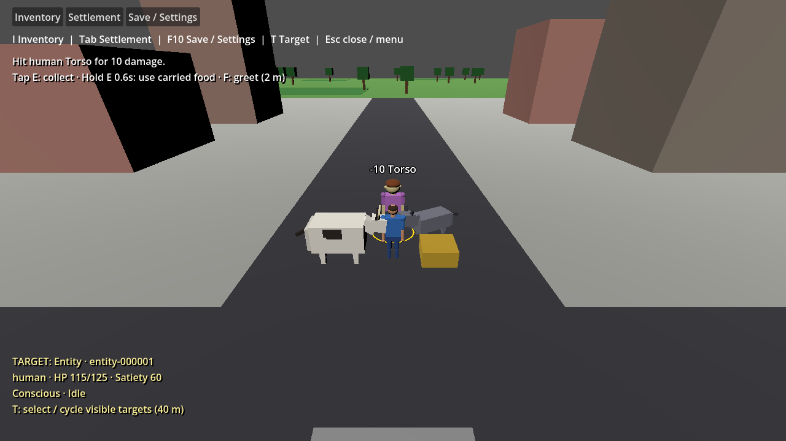

# Gameplay refinement after target selection

Issue [#390](https://github.com/jmart985/Unnamed-Project-2026/issues/390) fixes gaps found by user playtesting the #388 selection build. It extends existing World, melee/social combat, resource transfer and greeting services.

## Player controls

- **T** cycles visible targets within 40 m. Exposed mesh portions count, so humans overlapping low storage can be selected. Completely hidden targets remain excluded.
- **Mouse left/right** starts a swing and captures the current entity target. At impact it resolves once against that ID, even if selection changes during windup. Face the target (60-degree half-angle), stay within **2.2 m**, and keep a clear strike path. A miss reports its reason. Successful hits apply **10 × strength** damage to the existing pitch-selected body part and the existing defender-to-attacker `harmed` relationship event. The target HUD shows summed current/maximum body-part health, not a second health record.
- **F** greets a selected compatible creature within **2 m**. A success shows the directed player-to-target relationship values, an acknowledgment above the target, and **facing toward the live greeter during and after the greeting**. The view holds attention for at least two seconds and keeps facing the live greeter afterward while idle; purposeful movement can reclaim orientation. The creature keeps its existing job/order. Rejections are visible; wolves and humans retain their existing unsupported friendly-interaction capability. Incapacitated participants cannot exchange greetings.
- **Tap E**, releasing before **0.6 s**, collects **one unit** into carried inventory without nutrition. It uses the resource selected when the press began; without selection it chooses the nearest visible source with unreserved items. An entity target reports that a resource must be selected. Collection uses 2 m reach, a clear path and the player's configured inventory capacity (default 10). Empty, reserved, missing, distant or full requests leave all counts unchanged. Mixed contents choose the first available item in ordinal item-ID order.
- **Hold E for 0.6 s** uses **one compatible carried food item** in species diet order. The hold-progress hint explains the pending action. It never also collects or repeats during that press. Materials are not usable and a full player keeps the food. No automatic eating from ground sources occurs through this binding.

The same rules apply to existing remapped keyboard/mouse/controller bindings (default controller X collects/holds to use). Preferences stay version 2; no World snapshot migration is needed. Menus, pause, reset, save/load and window focus loss cancel pending input and target responses. Carried resources already persist in schema 10. Top-left gameplay feedback lasts six seconds and is also available in Settlement's Last action field; target responses use the existing live target position.

## Scope and limitations

Visibility and strike obstruction sample rendered mesh bounds; they are not per-triangle collision or final-art picking. This correction makes targeted swings functional, but does not introduce weapons, equipment, creature retaliation, dialogue or combat AI. Health persistence is the user-prioritized next correction under #302 and its focused implementation follow-up. This PR still uses the existing snapshot contract; a separate tested schema change will preserve injuries and death state. Greeting attention remains a live presentation response. The existing legacy direct-source eating handler remains available to historical survival regression scenarios; the gameplay Collect binding now uses carried items. Settlement's food counter describes ground food and direct-source consumption; carried-food use is reflected in inventory and player satiety.

## Validation and reproduction

Run the pinned README restore, Release solution build and full domain tests. Build the game in Debug for local Godot runs, then:

```powershell
$run = Start-Process '<Godot .NET executable>' -ArgumentList @('--path','game','--headless','--','--validate-gameplay-actions') -WindowStyle Hidden -Wait -PassThru
$run.ExitCode
```

Omit `--headless` for rendered evidence. Require exit 0 and `GAMEPLAY ACTIONS VALIDATION PASSED`. The fixture dispatches actual viewport keys/mouse/controller events and waits for actual physics swings; it also exercises an elapsed controller hold through Main's normal process callback. It checks overlapping humans, full obstruction, captured-target damage, social consequence, blocked/distant/missing/incapacitated rejection, visible greeting and facing through gait, unsupported/far greetings, pickup versus hold, progress, remapping and menu/pause/reset/load cancellation. Separate `refinement-validation-*.json` files isolate settings and save data.

Domain checks cover conservation, capacity/reservation rejection, atomic failure, food compatibility/fullness, carried-inventory persistence, incapacitated greetings, and exclusive press/hold/cancel outcomes. Selection, menu, first-game, squad and schedule Godot scenarios are neighboring regressions. Rendered evidence is written intentionally under `docs/evidence/gameplay-refinement/`.

Actual validation on 2026-10-03: restore, Release solution build and Debug game build passed; **548 tests passed, zero failed/skipped**. Focused gameplay validation passed headless and rendered, including real timed controller hold, actual strike events and greeting turn. Headless selection, menus, first-game, squad and schedules all passed. Screenshots below were inspected. Existing EntityView nullable warnings and unavailable NuGet audit NU1900 remain; no standalone formatting/lint/packaging workflow is configured. Diff whitespace checks passed.



