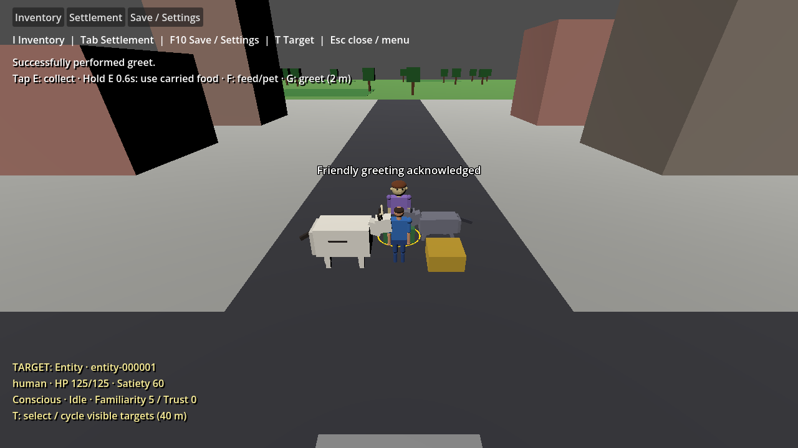

# Capture, feed, pet and give repair

Issue #393 corrects the interaction resolver introduced on main 1982661. `InteractionResult.Succeeded` describes an action that actually happened, with a visible failure reason otherwise. `ProvidedItem` is a one-item quantity descriptor; its counts are not another owned inventory. The actor's World inventory supplies the item.

- Physical and social entity interactions require distinct, present, conscious participants within 2 m. Missing, incapacitated, distant and self targets fail before mutation. Capture delegates to existing World captivity transitions; humans and repeated/invalid captures remain rejected.
- Feed uses one compatible carried unit per action, even when the descriptor or inventory contains a stack. Nutrition comes from the target's existing needs tuning. A full target keeps the actor's items. Missing food, species definitions or the required social profile fail without inventory or satiety changes.
- Pet requires the existing friendly-interaction species capability. A successful `helped` event records the recipient's response toward the actor; a rejected event returns failure. Give uses the same direction. Greeting retains the existing actor-to-target direction.
- Give transfers the requested positive single-item quantity through `ResourceTransferService`, validating ownership and the recipient's total configured capacity before mutation. Invalid quantities, mixed descriptors, missing items and full recipients preserve both inventories.
- New sessions and loaded Worlds retain their supplied species catalog. The resolver requires its relationship service to reference the same World. The accidentally committed obsolete `InteractionResolver.cs` file whose name ended in a backtick was removed; the normal `.cs` file is authoritative.

In gameplay, **F** feeds a selected creature when compatible food is carried, otherwise pets it. **G** greets humans or supported creatures. These are configurable bindings, and feedback shows the actual configured keys. Successful feed/pet/greeting displays acknowledgment and uses sustained attention: face the live actor during and after acknowledgment with no time limit, unless a new domain task or purposeful movement overrides it, or the actor/recipient separation exceeds 2 m. Exactly 2 m retains attention; moving closer again does not silently resume it without a new interaction. A stationary new task also overrides attention immediately. Failed interactions do not trigger acknowledgment. Menus and pause suppress these inputs. **E** remains tap-to-collect / hold-to-use-carried-food; targeted damage and health HUD behavior remain intact.

Capture and give are repaired domain requests; this issue does not introduce new menus or default keys for them. Existing structure door requests retain their toggle behavior with a reach check. No save schema, health model, retaliation, equipment or command execution system is introduced. Health persistence under #302 remains a separate pending correction.

## Validation

On 2026-10-04, pinned restore, Release solution build and Debug game build passed with **zero C# warnings/errors**. The full domain suite passed **565 tests, zero failed/skipped**; the existing separate InteractionTests project passed all **5 tests**. NuGet audit warning NU1900 remains because the service index is unavailable; no diagnostic was suppressed.

`--validate-gameplay-actions` passed headless and rendered in Godot 4.7.2 .NET. It dispatches actual F/G inputs, verifies feeding from a stack, full-target rejection, pet response, live capture/give outcomes, human and creature facing after acknowledgment, real melee hits/misses, collect/hold remapping and cancellation. `--validate-selection`, `--validate-menus`, `--validate-first-game`, `--validate-squad` and `--validate-schedules` each passed headless with exit 0. Existing README commands and the Start-Process validation procedure in [GAMEPLAY_REFINEMENT.md](GAMEPLAY_REFINEMENT.md) apply. Require the printed PASSED marker and actual process exit 0.

