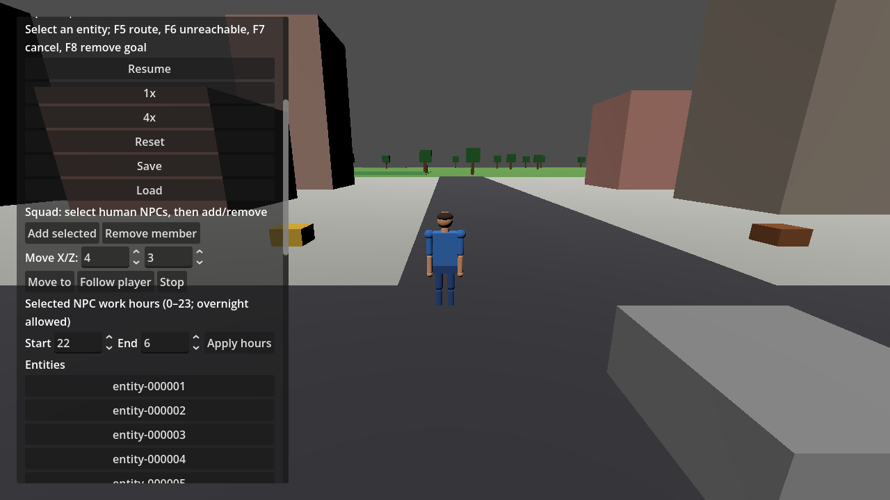
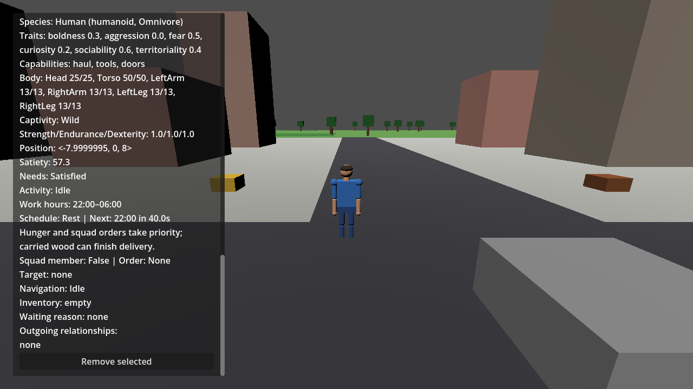

# NPC daily work/rest schedules

Milestone 1.1 selects schedules through #200, implemented in #380 and accepted in the dependent integration gate #381. Select a human NPC, edit Start/End under **Selected NPC work hours**, and press **Apply hours**. Hours are integers 0–23; equal hours reject without changing the schedule. Overnight windows such as 22:00–06:00 are valid. The inspector shows the committed hours, Work/Rest phase and next transition; editing the controls alone does not change the world. Creatures and the player have no schedule.

One day lasts 240 simulation seconds (10 seconds per game hour). Simulation time zero is 08:00 and the default work window is 08:00–18:00. Start is inclusive and end exclusive. Phase derives from the existing fixed-step simulation clock, so pause freezes it and 4x scales it. The day length and defaults are initial tuning, without a separate wall-clock timer or saved phase.

Rest prevents new wood pickups. Before navigation advances on a rest boundary, hauling cancels a pickup with no carried wood, releasing its navigation request and reservations through the existing action lifecycle. Carried wood can finish or retry delivery during rest; after depositing, the worker rests instead of collecting again. Hunger and direct squad orders keep their existing higher priority. Rest does not restore needs or health: fatigue, beds, sleep animation, new jobs and priority editing are deferred.

`World` owns explicit hour overrides keyed by entity ID. Defaults are a shared immutable policy; removal and reset discard overrides. Schema 10 adds `WorkSchedules`. Versions 4–9 migrate to default schedules while retaining their existing migration rules, including version 9 squad membership. Current snapshots require a schedule list, and reject duplicate, missing, player or creature references and invalid hours before clearing transient services or replacing the world. Actions, paths and reservations remain transient; carried inventory and clock time remain durable. `WoodHaulingService.Advance` accepts simulation time; runtime callers must pass the current clock time. The zero default preserves existing standalone service callers at the initial work phase.

## Reproduce validation

Run the root README restore, Release build and full test commands, then build the game assembly used by the editor:

```powershell
dotnet build game/UnnamedProject2026.csproj --configuration Debug --no-restore
& "C:\Developement\Godot\Godot_v4.7.2-stable_mono_win64\Godot_v4.7.2-stable_mono_win64.exe" --path game --headless -- --validate-schedules
```

Wait for process completion and require exit 0 plus `SCHEDULE VALIDATION PASSED`. The opt-in scenario uses real inspector button handlers and Godot navigation, verifies rejection, pickup cancellation before movement, next-day pickup, delivery during rest and schema 10 round trip with wood total 100. It holds the clock at boundary fixtures while navigation runs; natural clock progression and combined overrides belong to #381. It uses in-memory snapshots without modifying the player's save slot.

For rendered evidence, omit `--headless` and add `--schedule-screenshot=<absolute-output-path.png>`. This also writes `schedule-inspector.png` alongside the requested file.

## Feature evidence (2026-10-03)

- .NET 10.0.401 restore, Release solution build and Debug game build succeeded. Full suite: **539 passed, 0 failed, 0 skipped**, including 30 schedule cases.
- Godot 4.7.2 .NET headless and rendered scenarios both exited 0 with the success marker. Rendered OpenGL 3.3 used AMD Radeon RX 6400.
- Existing nullable warnings in `EntityView.cs` remain. Restore reports NU1900 because NuGet vulnerability data is unreachable; vulnerability audit remains unverified. No standalone formatter/linter is configured.




