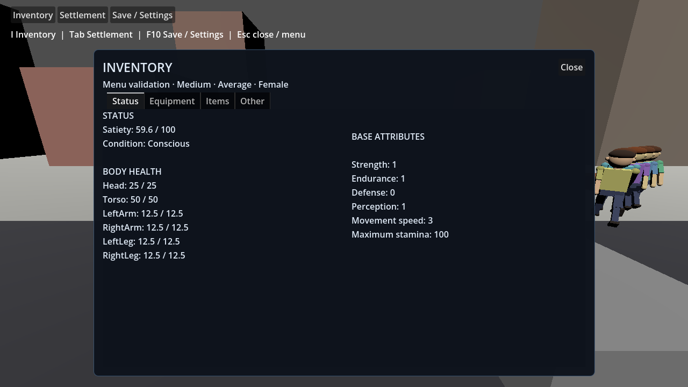
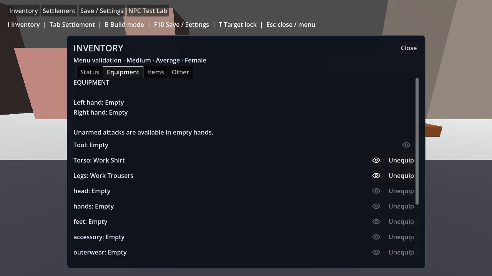
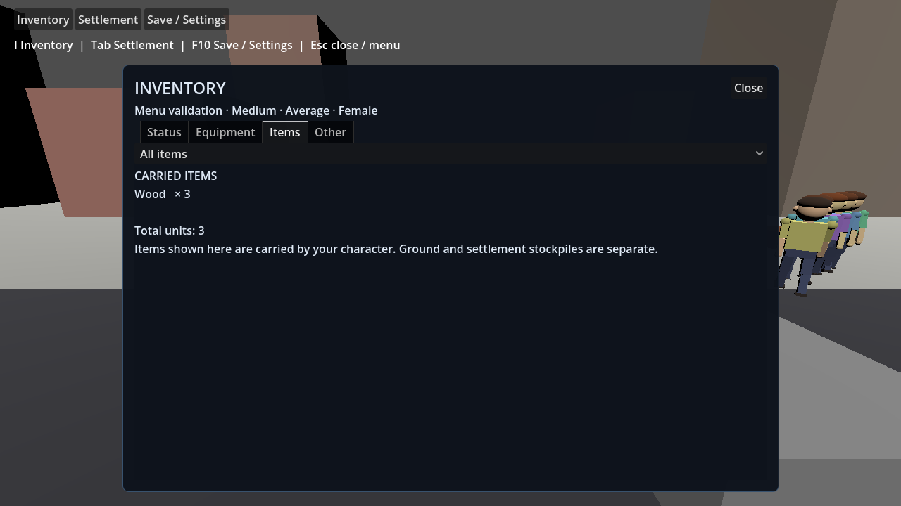
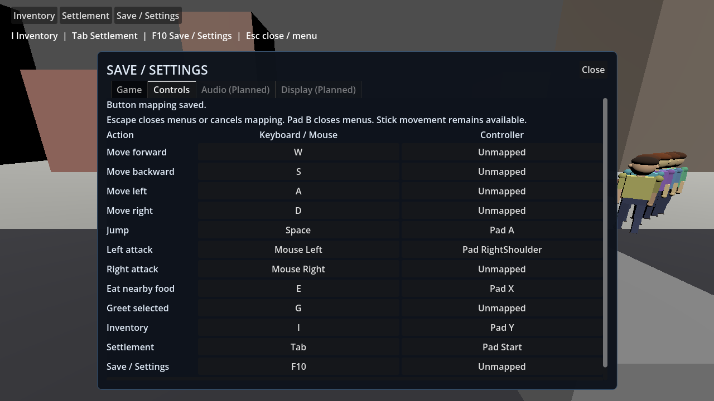
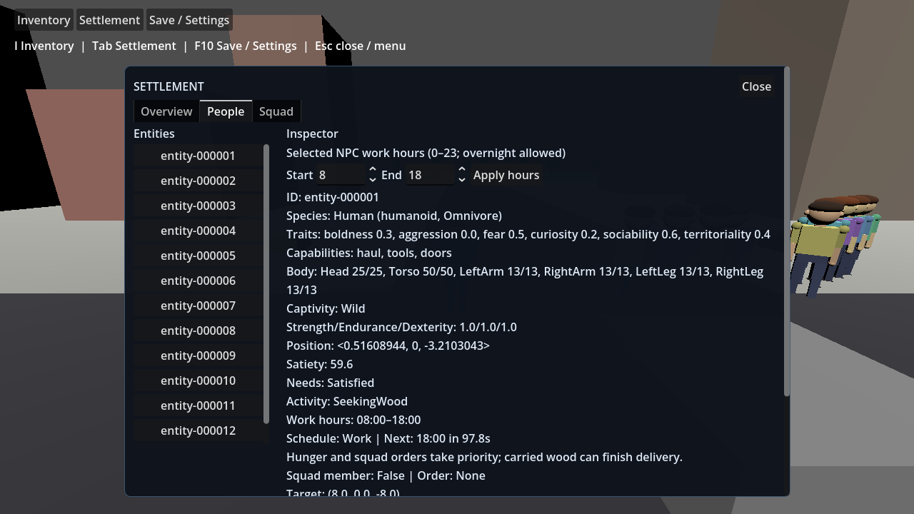

# Player menus and button mapping

Issue [#384](https://github.com/jmart985/Unnamed-Project-2026/issues/384) repairs the existing menu placeholder before further creature work.

## Screens

Use the permanent top-left navigation buttons, or the default bindings below. Only one screen is open at a time. Pressing its key again or its Close button closes it. Escape opens Save / Settings from gameplay and closes an open screen; during button capture it cancels capture first.

| Screen | Default | Tabs and content |
| --- | --- | --- |
| Inventory | I / View (touchpad) | Status: live satiety, body health and base attributes. Equipment: current tool, torso and legs slots, item equip/unequip actions, and per-slot visibility toggles. Items: actual player-carried counts, including unequipped clothing, empty state and All/Food/Materials/Currency/Clothing filtering. Other: existing skills, position and faction. |
| Settlement | N / LB + D-pad right | Overview: simulation totals, pause/resume, speed and Build mode. People: scrollable entity list beside inspection and daily schedule controls. Squad: selection, membership and move/follow/stop controls. |
| Save / Settings | Escape / Menu (Options) | Game: existing save/load slot and scenario reset. Controls: keyboard/mouse and controller button mapping, capture feedback and restore defaults. |

Panels use centered anchors, an opaque background and scrolling for overflow. Status uses two columns; settlement keeps the list beside the selected entity's detail instead of putting every control in one long debug column. Tabs retain their selection when switching screens. New/reset games start with screens closed and navigation visible.

An open Inventory, Settlement, or Save / Settings screen pauses single-player simulation and blocks walking, jumping, aim, attacks and world action hotkeys. Build mode is a separate non-modal placement context: it keeps movement, jumping, camera look, mouse capture and the centered reticle active while suppressing normal world actions. Its ten-slot keyboard bank uses 1–9 and 0 only while Build mode is open; these keys remain free for future inventory hotkeys elsewhere. Settlement pause/speed controls remain effective; save and load pause as before. Closing respects that pause state. Opening a regular screen cancels an unfinished player swing and horizontal movement so an attack cannot land behind the UI.

## Live state and future space

Inventory is a read-only projection of the current World player, resolved by ID on each refresh. It is not a second inventory. Atomic transfers, successful loads and resets update the view; a rejected load preserves the existing world and visible quantities. Ground resources and settlement storage are not carried items. The #384 UI slice does not add drop or equip transactions. Subsequent #390 adds menu-free pickup and carried-food use through existing atomic transfers; the Items tab shows those resulting carried counts. Tap E now performs the default contextual interaction; hold opens additional actions. Carried-food use is an explicit self/social wheel choice. See [unified controls](CONTROLS.md).

The Equipment tab projects the World player's equipment slots and their current items. The matching Items tab contains carried items that are not equipped, including clothing. An eye button on each occupied supported slot hides or shows only that slot's visual; it does not change equipment, inventory, or gameplay effects. Empty slots have disabled eye buttons. Visibility entered the entity snapshot in schema 25; older snapshots restore equipped items as visible. See D069.

Torso, legs, head, hands, feet, accessory and outerwear slots have concrete wearable definitions, shared-skeleton visuals, generic unequip controls and independent eye toggles. Each wearable row returns its current item to carried Items regardless of which garment was selected during creation; empty rows disable Unequip. Outerwear changes a jacket without replacing its torso shirt. The carried wardrobe selector equips compatible owned items. Creation uses the same sex-filtered catalogue; see [character creation](CHARACTER_CREATION_AND_BODY.md). Hair is a profile appearance choice rather than an inventory item.

Audio and Display are disabled **Planned** settings tabs with tooltips. Add real settings inside them when those capabilities are implemented. Other contains working skills and world information; it can receive future character information without crowding Status. Do not add speculative quest/crafting controls or enable placeholders before their acceptance criteria and systems exist.

Settlement > People also exposes ongoing employment, automatic assignment preference, finite workplace positions, and explicit assignment/unassignment. Employment is separate from current activity and survives task completion or temporary interruptions. The first supported job is a wood hauler assigned to a stockpile; additional production professions need their own executable work loops. See [NPC employment](NPC_EMPLOYMENT.md).

## Button mapping and persistence

Select a Desktop or Controller mapping button, then press the input or move a stick/trigger beyond its capture threshold. Modifier chords, signed axes and alternate bindings are supported. Context-aware conflict checks permit build/gameplay reuse and explicit tap/hold pairs. Escape cancels capture first. Search/category filters, a controller diagram, reset-category/reset-all, hold/toggle preferences, deadzone, inversion and sensitivity live on this screen.

Stable IDs remain in `Simulation.ControllerActions`; the Godot facade forwards compatibility constants. The Godot-side catalog owns defaults, contexts and availability. Build slots use 1–9 and 0 only in Build context; outside it the row is reserved for future quickslots and performs no build action.

Preferences remain separate from World snapshots at `user://player-settings.json`. Version 5 validates the complete profile, atomically backs up valid versions 1–4, and activates the approved defaults once. A failed backup/save leaves the previous file and active preferences intact; corrupt profiles are preserved and reported. HUD hints and controller legends derive from current bindings. See [unified controls](CONTROLS.md) for the authoritative layout and reserved features.

Gameplay targeting now works without a menu; see [World target controls and validation](WORLD_SELECTION.md).

## Validation and reproduction

Pinned toolchain: Godot 4.7.2 .NET `ed1daf0bf`, .NET SDK 10.0.401. After the documented restore/build/test commands in README, build the game Debug assembly and run:

```powershell
dotnet build game/UnnamedProject2026.csproj --configuration Debug --no-restore
& '<Godot .NET executable>' --path game --headless -- --validate-menus
& '<Godot .NET executable>' --path game -- --validate-menus
```

Require exit 0 and `MENU VALIDATION PASSED`; compilation alone is insufficient. The scenario uses dispatched viewport input, UI button signals, real player physics and real InputMap. It checks screen switching/toggle/close, empty/current inventory, item categories, movement/aim/combat/action isolation, gameplay recovery, atomic transfers, save/load and invalid-load preservation, capture conflict/cancellation, keyboard/mouse/controller mapping, new-instance reload, failed-write preservation, restore defaults, rebound keyboard/mouse attacks reaching real swings while the old mouse binding no longer attacks, and reset without stale character references.

Validation isolates each run's save/preferences under unique `.menu-validation-save-<run>.json` and `.menu-validation-settings-<run>.json` files beside the checkout. This avoids stale fixtures and user-profile ACL/locking issues. All `--validate-*` scenarios bypass user preferences to retain reproducible default input. A rendered run writes intentional evidence images under `docs/evidence/player-menus/`.

Actual validation on 2026-10-03: Release solution build and Debug game build succeeded; full domain suite 541 passed. Menu validation passed headless and rendered. Inspected screenshots include 1280×720 and a 960×600 window. First-game, squad and schedule engine regressions passed. Existing EntityView CS8604 warnings and unavailable NuGet vulnerability audit NU1900 remain; no standalone formatter/linter or packaging check is configured by the repository.






