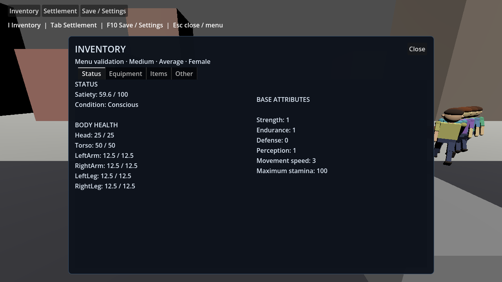
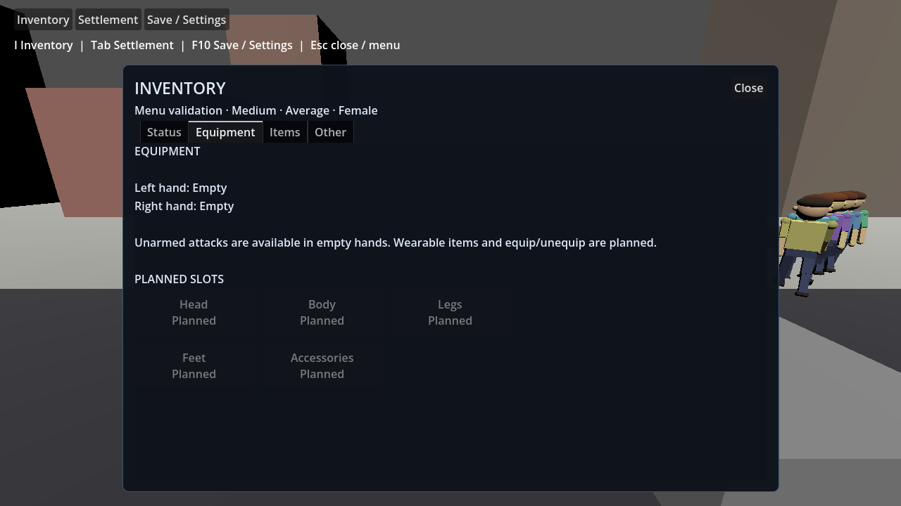
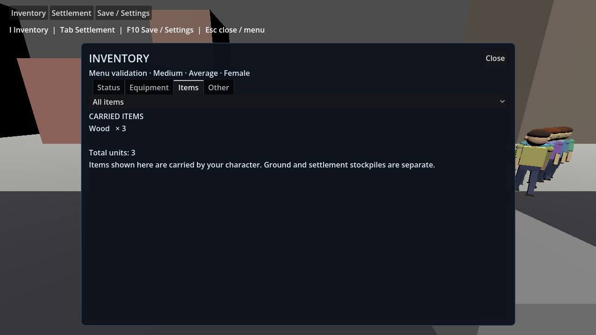
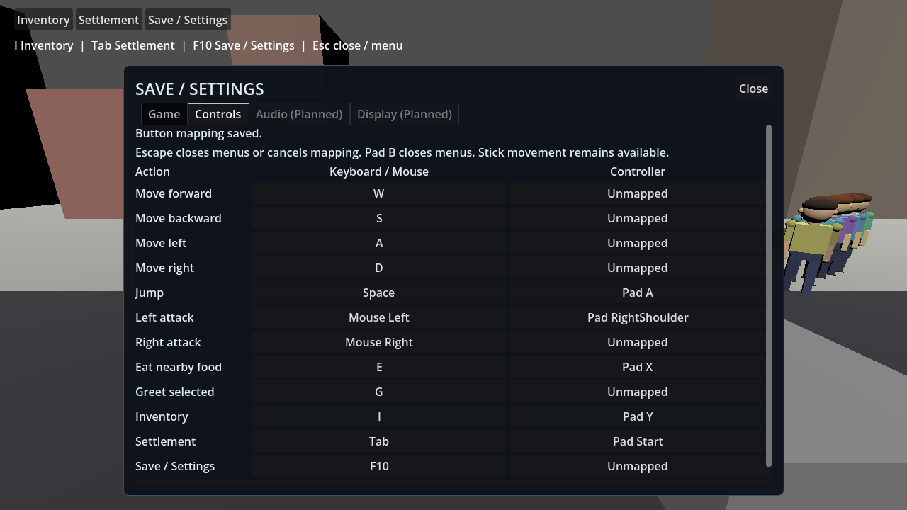
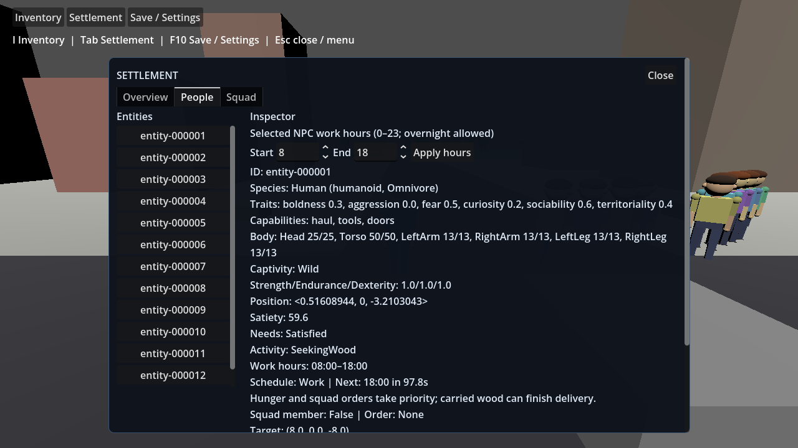

# Player menus and button mapping

Issue [#384](https://github.com/jmart985/Unnamed-Project-2026/issues/384) repairs the existing menu placeholder before further creature work.

## Screens

Use the permanent top-left navigation buttons, or the default bindings below. Only one screen is open at a time. Pressing its key again or its Close button closes it. Escape opens Save / Settings from gameplay and closes an open screen; during button capture it cancels capture first.

| Screen | Default | Tabs and content |
| --- | --- | --- |
| Inventory | I / controller Y | Status: live satiety, body health and base attributes. Equipment: current left/right hand shield configuration and planned wearable slots. Items: actual player-carried counts, empty state and All/Food/Materials/Currency filtering. Other: existing skills, position and faction. |
| Settlement | Tab / controller Start | Overview: simulation totals, pause/resume, speed and Build mode. People: scrollable entity list beside inspection and daily schedule controls. Squad: selection, membership and move/follow/stop controls. |
| Save / Settings | F10 / Escape when closed | Game: existing save/load slot and scenario reset. Controls: keyboard/mouse and controller button mapping, capture feedback and restore defaults. |

Panels use centered anchors, an opaque background and scrolling for overflow. Status uses two columns; settlement keeps the list beside the selected entity's detail instead of putting every control in one long debug column. Tabs retain their selection when switching screens. New/reset games start with screens closed and navigation visible.

An open Inventory, Settlement, or Save / Settings screen blocks walking, jumping, aim, attacks and world action hotkeys. Build mode is a separate non-modal placement context: it keeps movement, jumping, camera look, mouse capture and the centered reticle active while suppressing normal world actions. Its ten-slot keyboard bank uses 1–9 and 0 only while Build mode is open; these keys remain free for future inventory hotkeys elsewhere. Settlement pause/speed controls remain effective; save and load pause as before. Closing respects that pause state. Opening a regular screen cancels an unfinished player swing and horizontal movement so an attack cannot land behind the UI.

## Live state and future space

Inventory is a read-only projection of the current World player, resolved by ID on each refresh. It is not a second inventory. Atomic transfers, successful loads and resets update the view; a rejected load preserves the existing world and visible quantities. Ground resources and settlement storage are not carried items. The #384 UI slice does not add drop or equip transactions. Subsequent #390 adds menu-free pickup and carried-food use through existing atomic transfers; the Items tab shows those resulting carried counts. The existing Collect mapping now means tap to collect / hold 0.6 s to use, preserving settings version 2 and every saved binding.

Equipment currently reflects the controller's existing left/right shield flags. These flags are prototype configuration, not durable equipped-item records. Head, body, legs, feet and accessories are disabled **Planned** slots. They reserve layout space without inventing wearable assets or save state. Their final item rules and slot definitions need their own scoped implementation before enabling them.

Audio and Display are disabled **Planned** settings tabs with tooltips. Add real settings inside them when those capabilities are implemented. Other contains working skills and world information; it can receive future character information without crowding Status. Do not add speculative quest/crafting controls or enable placeholders before their acceptance criteria and systems exist.

## Button mapping and persistence

Select a Keyboard / Mouse or Controller mapping button, then press the new input. Keyboard mapping uses unmodified physical keys; mouse mapping accepts left/middle/right and auxiliary buttons, not wheel axes. Controller mapping accepts buttons; existing stick movement remains available. Each action has one desktop binding and an optional controller button. Axis remapping and modifier chords are outside this slice.

Duplicate bindings are rejected with feedback. Escape, controller B and debug F5–F8 remain reserved. Escape cancels capture without closing Settings. Restore defaults resets and saves the mapping. The legacy combat alias follows left attack rather than keeping an obsolete binding.

Stable action IDs live in `Simulation.ControllerActions`; the Godot-facing `ControllerActions` type forwards them as compatibility constants. Keep these IDs unchanged unless a settings migration is included, because saved preferences store the action names.

Build mode is a contextual control exception: its configurable open/toggle action defaults to B / controller left-stick click. The slot bank (1–9, 0) is read only while that mode is active and is deliberately not added to global InputMap action bindings. This leaves those keys available outside build mode for later inventory shortcuts. Controller D-pad left/right cycles through the four current build options only in Build mode; left attack confirms placement in that context.

Preferences are stored separately at `user://player-settings.json`, through the existing atomic `SaveSlotStore`. Issue #388 adds Cycle target (default T) and uses version 2 for new writes. Version 1 loads preserve every existing binding and add an unused target key (T, or F9 then other free keys if T is already assigned); migration does not overwrite the file until a settings change is saved. New/restored defaults use F for greeting; existing G/custom mappings remain intact. The complete file is validated before changing InputMap; a failed write retains both the previous file and active mapping. Invalid settings report a load error and retain the active mapping. A settings change never changes World snapshots or their schema 10. Navigation hints and mapping buttons refresh from the actual bindings.

Gameplay targeting now works without a menu; see [World target controls and validation](WORLD_SELECTION.md).

## Validation and reproduction

Pinned toolchain: Godot 4.7.2 .NET `ed1daf0bf`, .NET SDK 10.0.401. After the documented restore/build/test commands in README, build the game Debug assembly and run:

```powershell
dotnet build game/UnnamedProject2026.csproj --configuration Debug --no-restore
& '<Godot .NET executable>' --path game --headless -- --validate-menus
& '<Godot .NET executable>' --path game -- --validate-menus
```

Require exit 0 and `MENU VALIDATION PASSED`; compilation alone is insufficient. The scenario uses dispatched viewport input, UI button signals, real player physics and real InputMap. It checks screen switching/toggle/close, empty/current inventory, item categories, movement/aim/combat/action isolation, gameplay recovery, atomic transfers, save/load and invalid-load preservation, capture conflict/cancellation, keyboard/mouse/controller mapping, new-instance reload, failed-write preservation, restore defaults, rebound keyboard/mouse attacks reaching real swings while the old mouse binding no longer attacks, and reset without stale character references.

Validation isolates each run's save/preferences under unique `.menu-validation-save-<run>.json` and `.menu-validation-settings-<run>.json` files beside the checkout. This avoids stale fixtures and user-profile ACL/locking issues. All `--validate-*` scenarios bypass user preferences to retain reproducible default input. A rendered run writes intentional evidence images under `docs/evidence/player-menus/`.

Actual validation on 2026-10-03: Release solution build and Debug game build succeeded; full domain suite 541 passed. Menu validation passed headless and rendered. Inspected screenshots include 1280×720 and a 960×600 window. First-game, squad and schedule engine regressions passed. Existing EntityView CS8604 warnings and unavailable NuGet vulnerability audit NU1900 remain; no standalone formatter/linter or packaging check is configured by the repository.






