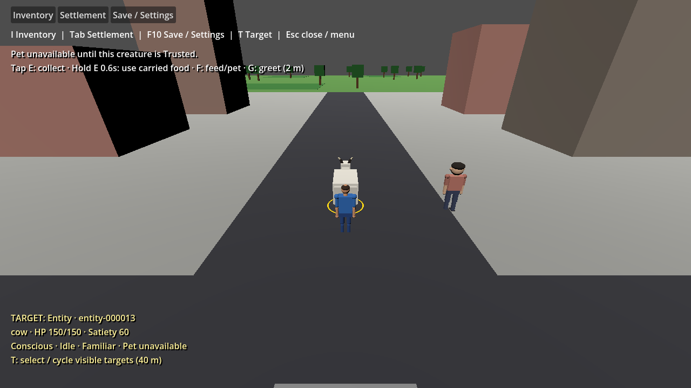
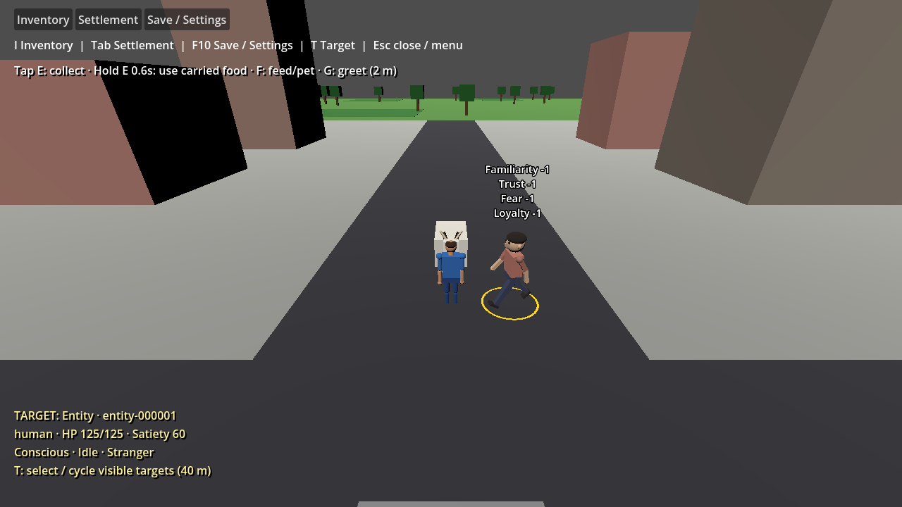
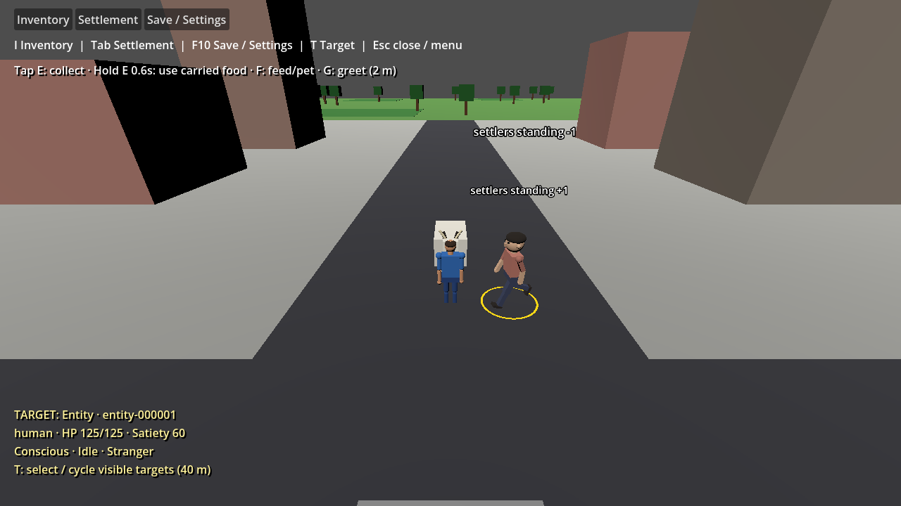

# Relationship feedback and Trusted petting

Issue #397 corrects the current interaction loop. The useful bond is the **recipient's attitude toward the actor**. Feeding, petting, giving, greeting and threatening use that direction for creatures and NPCs. Successful damage still applies `harmed` from defender toward attacker. The player's outgoing relationship display is hidden; the player remains in the authoritative World and cannot be captured.

Gameplay and the settlement inspector show qualitative bonds instead of persistent Familiarity/Trust/Fear/Loyalty totals. Applied changes float above the recipient for three real-time seconds, rising and fading independently of the action acknowledgment. All nonzero entries in the production social event profiles are +1 or −1. Feedback reports the actual applied change: clamped dimensions, failed interactions and unchanged values produce no fabricated gain/loss. The four dimensions remain separate, bounded internally to [0, 100].

## Pet permission and domestic defaults

- The existing bond classifier is authoritative: Trusted requires familiarity ≥20 and trust ≥50; Loyal also qualifies. Fearful (fear ≥50) overrides these bonds and prevents petting. A qualifying creature has a green selection ring and `Pet available`; otherwise its ring is gold and `Pet unavailable`. Changes take effect immediately.
- **F** feeds one compatible carried unit when the creature is hungry. Otherwise it attempts petting, including when the creature is full and the player still carries food. Petting requires a conscious nearby Trusted/Loyal creature. Wild species may become pettable through a qualifying bond, even if they initially reject greetings. **G** still uses the existing friendly-greeting species capability. Bindings remain configurable.
- `species.json` identifies domestic species and predators. Cows are domestic with provisional base trust 50; their initial familiarity is the existing Familiar threshold (20), making them initially Trusted toward humans and non-predators. Wolves are predators. Optional fields preserve legacy catalogs: `isDomestic` defaults false, `baseTrust` defaults zero, and `isPredator` defaults to whether the diet is Carnivore. Base trust must be finite within [0, 100].
- Defaults apply only to a new directed record. Read-only bond queries can classify an absent record using these initial defaults without creating it. Existing records, including betrayed or zero-trust records, are never reset or floored. No passive relationship regeneration is added.

`World.RelationshipChanged` and `World.FactionStandingChanged` notify the view after successful authoritative mutations with applied deltas. `World.ApplyFactionStandingEvent` provides +1/−1 faction event steps, using the existing faction bounds/rejection rules. Explicit adjustment APIs keep their supplied quantities for setup/imports; they are not silently normalized. Faction feedback names the affected faction above the entity whose standing changed. This slice does not add quests, faction reward triggers or an autonomous reputation loop; the existing faction event path is exercised directly in engine validation.

## Save compatibility and interaction invariants

The save schema is unchanged. Saved numeric relationships and standing remain authoritative and restore exactly, bypassing domestic initialization. Defaults and snapshot restoration do not emit feedback. Menus, pause, focus loss, reset and load clear pending popups. Existing health, atomic inventory transfer, sustained greeting attention, 2 m interaction reach, target selection, tap E collection/hold E use, and follow spacing remain intact. Health persistence #302 and advanced creature planning #201 retain their separate scope.

## Validation

Use the pinned .NET 10.0.401 and Godot 4.7.2 .NET commands in README. Build the Debug game before engine scenarios. Run Godot with `--path game --headless -- --validate-social-feedback`; omit `--headless` for rendered evidence. Require exit 0 and the `SOCIAL FEEDBACK VALIDATION PASSED` marker. The scenario dispatches real F/G and melee inputs, checks 49→50→51→49 trust transitions, ring colors and pet permission, damage, all relationship dimensions, NPC/faction feedback, expiry/menu isolation and save/load. Its disposable save is `user://social-feedback-validation-save.json`.

Rendered evidence on 2026-10-04:

Pinned restore, Release solution build and Debug game build passed with zero C# warnings/errors. The full Simulation suite passed **580 tests**, and the separate InteractionTests suite passed **5 tests**, with no failures/skips. Social feedback passed headless and rendered. Headless gameplay-actions, selection, menus, first-game, follow-spacing, squad and schedules all passed with exit 0. NuGet audit warning NU1900 remains because its service index was unavailable; no check or diagnostic was suppressed. No separate formatting/lint/packaging workflow is configured; the compiler, behavioral suites and diff whitespace check are the applicable checks.

