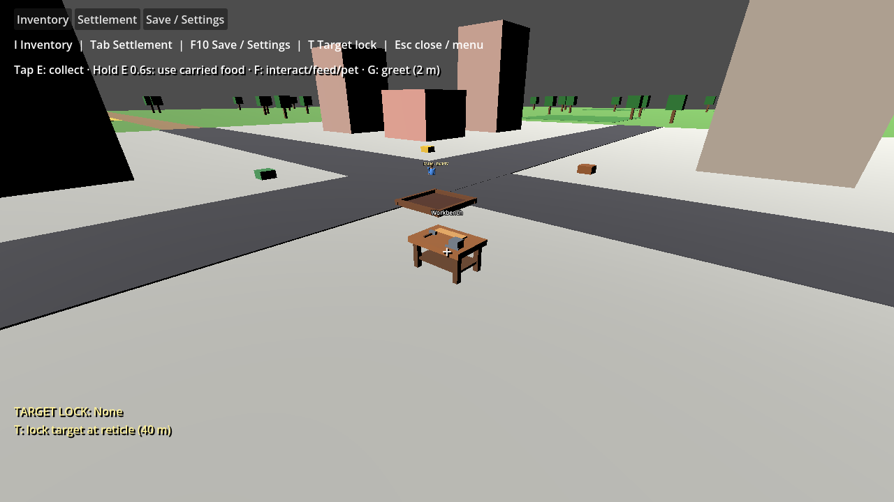
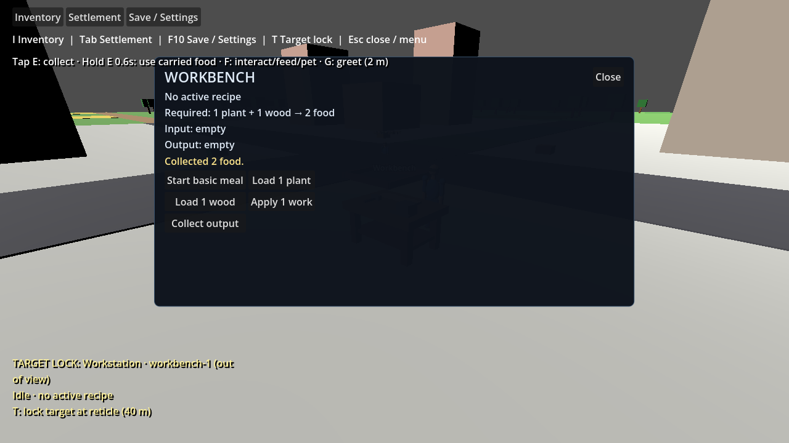

# Town workbench placement and presentation

Issue #399 replaces the original obstacle cube with a recognizable workbench. Issue #481 moves the starter `workbench-1` into the paved town work area at `(10, 0, 10)`, clear of both road strips and the crossroads. The World-owned workstation position drives its visual mesh and collision, and the Godot scene retains the wooden tabletop, four legs, shelf, vise, hammer, workpiece and billboard label.

The model fits the paved cell between the central roads and buildings, with clear space around the nearby farm. Visual selection/strike occlusion checks the actual tabletop and child meshes, including the open gaps, rather than a solid cube. Rebuilding after reset removes old children before adding replacement geometry. Loading rebuilds the landmark at the loaded workstation position.

The original #399 change was a presentation correction. The later #401 work connected the bench to the existing workstation recipe and inventory actions, and save schema 11 made its state durable. This placement change keeps those interactions and moves the rendered obstacle together with its authoritative World position; it adds no recipes, jobs or build-mode behavior.

Starter humans use a clear row at the crossroads, away from the relocated workbench. The first-game Godot validation checks actual player, NPC and workbench collision-shape bounds before physics can depenetrate anything, then routes an NPC from the crossroads to the workbench approach and back using real navigation. Existing schema 11–20 saves move only the fixed `workbench-1` instance from the old origin to the new placement; its input, output, recipe and progress are preserved in schema 21. Other saved workstation positions remain unchanged.

## Validation

Use the pinned README setup. Build the Debug game, then run Godot with `--path game --headless -- --validate-workbench`; omit `--headless` to capture rendered evidence. Require exit 0 and `WORKBENCH VALIDATION PASSED`. The scenario checks that domain, rendered and collision positions match outside both road strips, absence of the old obstacle node, label/bench visibility, actual sight-ray obstruction at the tabletop and clearance beneath it, player interaction at the new location, and repeated reset/load without duplicate geometry. Its disposable save is `user://workbench-validation-save.json`.

On 2026-10-23, Release solution and Debug game builds passed with zero C# warnings/errors, and all **685 simulation tests** passed. Rendered and headless workbench validation passed, including the off-road location and durable workstation state. The first-game Godot validation passed, including an NPC navigating from the crossroads to the relocated bench and back. The headless renderer reports its existing shutdown resource warnings, and this fresh worktree has not imported the humanoid/creature GLB files; neither affects the bench or navigation assertions. Diff whitespace checks passed. No separate formatting/lint/packaging workflow is configured.

