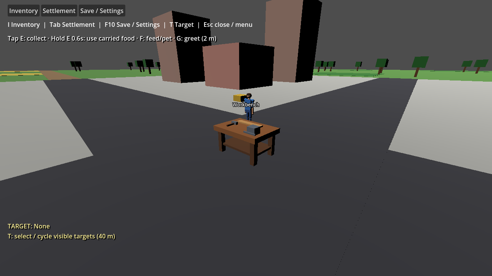

# Town-center workbench presentation

Issue #399 fixes the central workbench being shown as the original obstacle cube. `NewGameSession` already creates `workbench-1` at the town origin. The starter placement and static town prop now share `TownWorkbenchPosition`; the Godot scene uses a named Workbench mesh with a wooden tabletop, four legs, shelf, vise, hammer and workpiece, plus a billboard label.

The model fits the existing central 2 m × 2 m navigation exclusion. Visual selection/strike occlusion checks the actual tabletop and child meshes, including the open gaps, rather than the old solid cube. Rebuilding after reset removes old children before adding the replacement geometry. Loading retains the static town landmark.

This is a presentation correction. Existing workstation recipe and inventory execution remain unchanged. Crafting selection/controls are not yet connected to the bench, and the existing snapshot contract does not serialize workstation state. Showing the static landmark after load does not manufacture a new authoritative workstation or pretend that crafting progress was restored. Workstation persistence and a playable crafting UI require separate concrete scope; no new save schema, recipe catalog, jobs or framework is added here.

## Validation

Use the pinned README setup. Build the Debug game, then run Godot with `--path game --headless -- --validate-workbench`; omit `--headless` to capture rendered evidence. Require exit 0 and `WORKBENCH VALIDATION PASSED`. The scenario checks the existing domain placement, absence of the old obstacle node, label/bench visibility, actual sight-ray obstruction at the tabletop and clearance beneath it, unchanged navigation exclusion, and repeated reset/load without duplicate geometry. Its disposable save is `user://workbench-validation-save.json`.

On 2026-10-04, Release solution and Debug game builds passed with zero C# warnings/errors, and all **580 simulation tests** passed. Workbench validation passed headless and rendered. Selection, gameplay-actions, first-game and follow-spacing headless regressions passed with exit 0. NU1900 remains for unavailable local NuGet vulnerability audit metadata; no diagnostic/check was suppressed. Diff whitespace checks passed. No separate formatting/lint/packaging workflow is configured.

