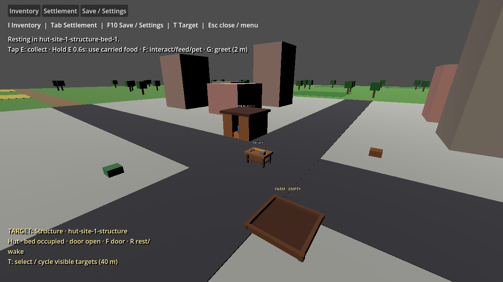

# 0.4 playable Basic Settlement acceptance

Selected target: #406. This gate accepts the player-visible Basic Settlement loop after the domain-foundation issues and the focused playable corrections #401, #403, #404 and #405.

## Accepted playable loop

From a fresh seed-42 game, the player can complete one integrated settlement cycle through visible targets and controls:

1. Target the town workbench, press Interact, load one plant and one wood, apply five work steps and collect two food.
2. Target the starter farm, press Interact, plant one carried plant, apply five growth steps and harvest three food.
3. Open Settlement controls, place one starter hut from the green preview, confirm the site, target it, supply six wood and apply five work steps.
4. Target the completed hut, press Interact to close/open the door, then press Rest to reserve the sheltered bed and enter rest.
5. Save/load while resting, then press Rest again to wake and release the bed.

The validation uses the same authoritative `World` collections and the same player-facing workbench, farm, construction, door and rest controls used in normal play. Inventory transitions use the atomic transfer services; no parallel UI-only settlement state is introduced.

## Evidence from 2026-10-04

| Check | Actual result |
| --- | --- |
| Release solution build | Succeeded, zero errors |
| Debug Godot assembly build | Succeeded, zero errors |
| Focused Basic Settlement headless scenario | Exit 0, `BASIC SETTLEMENT VALIDATION PASSED` |
| Focused Basic Settlement rendered scenario | Exit 0, `BASIC SETTLEMENT VALIDATION PASSED`; OpenGL 3.3 / AMD Radeon RX 6400 |
| Rendered evidence | Wrote `docs/evidence/basic-settlement/playable-loop.png` |

The focused scenario validates the integrated happy path plus failure recovery:

- Workbench before/after inventory: one plant and one wood leave carried inventory through load controls; five work steps produce and collect two food.
- Farm before/after inventory: one plant is consumed; five growth controls mature the plot; harvest adds three food.
- Construction before/after inventory: two food are atomically deposited to the stockpile to free carry capacity; six wood are picked up, supplied one at a time, and consumed by the site before five work steps complete the hut.
- Door and shelter: the hut is targetable after site replacement; Interact toggles door closed/open; Rest reserves the bed and marks the player sleeping; save/load preserves the occupied bed and sleep state; Rest wakes and releases occupancy.
- Mid-progress durability: a second validation setup saves and loads partial workstation input/work, planted farm growth, an in-progress construction site, a completed shelter, occupied bed and sleeping player.
- Invalid-load rollback: corrupted construction material progress is rejected and leaves the live world unchanged.
- Reset/repeated load safety: repeated reset returns to exactly one starter workbench and farm and no duplicate sites, structures, beds, resources or constructed presentation.

## Reproduce

From the repository root:

```powershell
dotnet build UnnamedProject2026.slnx --configuration Release
dotnet build game\UnnamedProject2026.csproj --configuration Debug --no-restore
& "C:\Developement\Godot\Godot_v4.7.2-stable_mono_win64\Godot_v4.7.2-stable_mono_win64.exe" --path game --headless -- --validate-basic-settlement
& "C:\Developement\Godot\Godot_v4.7.2-stable_mono_win64\Godot_v4.7.2-stable_mono_win64.exe" --path game -- --validate-basic-settlement
```

On Windows, prefer `Start-Process -Wait -PassThru` when collecting exit status from the Godot executable. The rendered command writes `docs/evidence/basic-settlement/playable-loop.png`.

## Limits and next work

This acceptance keeps the prototype bounded to one starter workbench, one starter farm, one starter hut blueprint and one visible sheltered bed. It does not add fatigue, ownership, worker job automation, free-form construction, final art, broader economy balance or advanced creature behavior. Deferred #302, #306 and #369 remain separate backlog/follow-up issues after this Basic Settlement acceptance gate.


