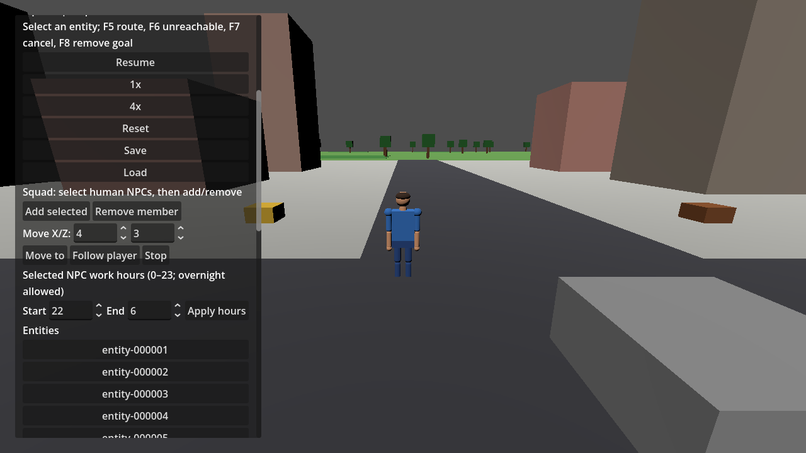
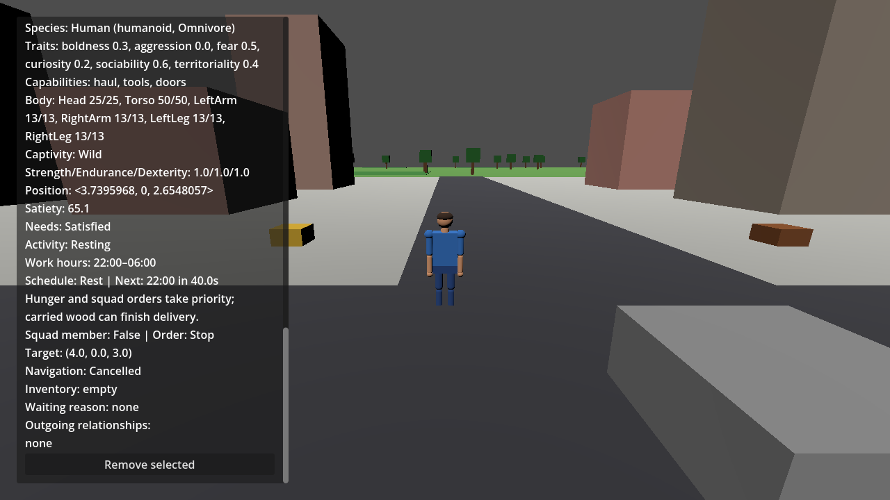
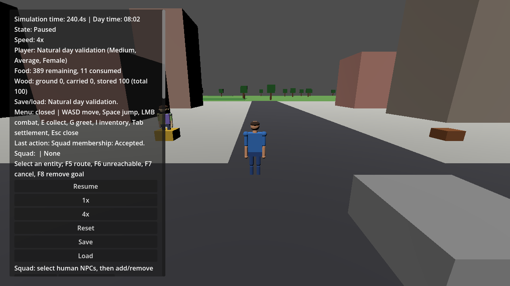

# 1.1 daily work/rest acceptance

Selected target: #200. Feature: #380 / PR #382, accepted on main `26288f5`. Integration gate: #381. The minimum playable loop is configurable human NPC work hours, rest without new hauling pickups, safe carried delivery, higher-priority hunger and direct squad orders, explanatory inspection and durable schedule settings. See [behavior and migration contract](NPC_SCHEDULES.md).

## Checks run on 2026-10-03

| Check | Actual result |
| --- | --- |
| .NET 10.0.401 restore | Succeeded; NU1900 audit warning |
| Release solution build | Succeeded, zero errors |
| Full Release domain suite | **540 passed, 0 failed, 0 skipped** |
| Schedule feature coverage | 30 cases for boundaries/overnight windows, pause/speed, rejection, reservation cleanup, delivery recovery, precedence, settings cleanup and schema 4–9 migrations |
| Combined domain scenario | Pass; repeated execution produces identical durable JSON |
| Debug Godot assembly build | Succeeded, zero errors |
| Godot 4.7.2 headless integration | Exit 0, `SCHEDULE INTEGRATION PASSED` |
| Godot 4.7.2 rendered integration | Exit 0, same success marker; OpenGL 3.3 / AMD Radeon RX 6400 |
| First-game engine regression | Exit 0, `FIRST GAME VALIDATION PASSED`; food 399, wood 100 |
| Squad engine regression | Exit 0, `SQUAD VALIDATION PASSED`; schema 10 load |
| Diff whitespace | `git diff --check` passed |

## Current boundary repair (#451, 2026-10-23)

The original engine assertion expected the NPC to become idle as `Resting` at the boundary. The current schedule behavior instead cancels the haul and starts the existing home-return trip, so the integration now checks that the haul request is replaced by a distinct home navigation request before later work can resume. To keep the rest of the gate focused and repeatable, its next-shift pickup and rest-time delivery use short real navigation paths near the source and stockpile, and the squad-override check uses a short path near its target rather than the crowded town crossing.

The natural-day case primes one NPC at satiety 20 to exercise hunger and eating during the 240-second schedule loop. With the current slow default needs tuning, a fresh NPC would not become hungry during that short loop. The current engine check exits 0 with both schedule markers; it records 399 food remaining, 1 consumed and 100 wood. This is a prepared hunger-response check, not a claim about hunger depletion from normal starting needs in one game day.

Current verification: Release solution build and Debug game build succeeded with zero warnings/errors; **634 Simulation.Tests passed**. Godot 4.7.2 Mono `--validate-schedules` exited 0 with `SCHEDULE VALIDATION PASSED`; `--validate-schedule-integration` exited 0 with both schedule markers.

The combined domain scenario advances the actual fixed-step clock through work at 99.9s, rest at 100s, next-day work at 240s and rest at 340s. A pickup cancels and releases reservations at rest. Hungry NPCs reach and consume reserved food during rest; squad movement also overrides rest. A carried delivery is preempted by a squad order, later interrupted by hunger, saved with an active delivery, and restored. Invalid schedule hours preserve both the durable world and active action. Valid load cancels stale navigation, retains cargo, and resumes delivery during rest without another pickup. Final wood is 100, food is 398; the final durable state is identical across both executions.

The engine gate exercises the same inspector button handlers used in play. It validates invalid/equal hours, edits and loaded controls, boundary cancellation before movement, next-day real navigation and delivery during rest. Saving while carrying retains cargo and removes stale navigation on valid load; invalid load preserves the old active request. The hungry worker then reaches food using real navigation, follows a direct squad order while its inspector still reports Rest, and returns to resting after squad removal.

The original 2026-10-03 seed-42 run reported 389 food remaining plus 11 consumed at 240.4 seconds. The current audit uses an explicitly hungry worker for its bounded day check and reports 399 remaining plus 1 consumed; this newer result is the current validation evidence. Pause preserves complete world state; each supplied 0.1-second frame advances four ticks, every frame asserts wood conservation and food accounting, and every rest frame rejects empty pickup actions. Boundary navigation fixtures remain separate from the natural clock loop.

## Reproduce

Run root README restore/build/test commands and:

```powershell
dotnet build game/UnnamedProject2026.csproj --configuration Debug --no-restore
& "C:\Developement\Godot\Godot_v4.7.2-stable_mono_win64\Godot_v4.7.2-stable_mono_win64.exe" --path game --headless -- --validate-schedule-integration
& "C:\Developement\Godot\Godot_v4.7.2-stable_mono_win64\Godot_v4.7.2-stable_mono_win64.exe" --path game --headless -- --validate-first-game
& "C:\Developement\Godot\Godot_v4.7.2-stable_mono_win64\Godot_v4.7.2-stable_mono_win64.exe" --path game --headless -- --validate-squad
```

Wait for the Godot process to finish; require the scenario marker and exit 0. On Windows a shell invocation may return before the GUI executable exits; use `Start-Process -WindowStyle Hidden -Wait -PassThru` when collecting exit status. The scenarios use in-memory snapshots and do not change the player's save slot.

For rendered evidence omit `--headless`, then add `--schedule-screenshot=<absolute-controls-path.png>` (also writes `schedule-inspector.png` alongside it) and `--day-screenshot=<absolute-day-path.png>`.

## Limits and next milestone

Two existing `EntityView.cs` nullable warnings remain. NuGet vulnerability metadata was unavailable (NU1900); package audit is unverified. No standalone formatter/linter or packaging check is configured. Local Godot checks supply engine evidence; GitHub CI runs restore/build/domain tests. The deterministic guarantee tested here is the domain durable state, not identical rendered pixel output or path coordinates across hardware.

Fatigue, beds, sleep animation, new jobs and priority controls remain outside this selected slice. Health persistence (#302), future tool/door actions (#306) and regional population (#369) retain their existing deferred scopes. After #381 merges, #200 can close and 1.1 has no remaining open issues. The next milestone is **1.2 Advanced Creature Behavior**, planning issue #201; its minimum playable target needs concrete scope before implementation. Existing creature decisions/perception and navigation should be reused.






