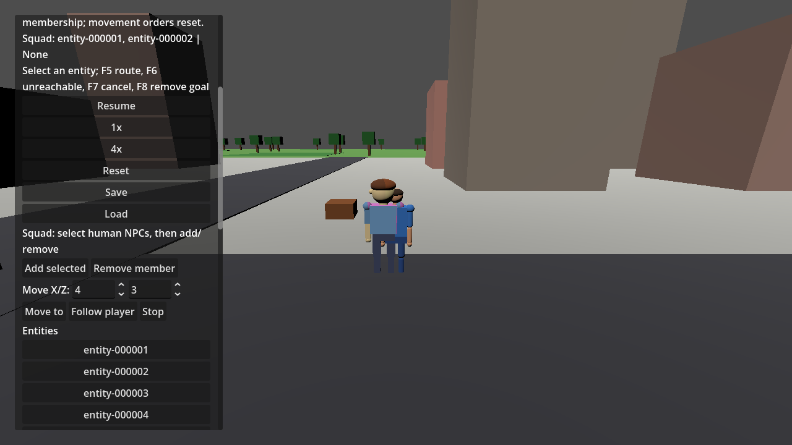
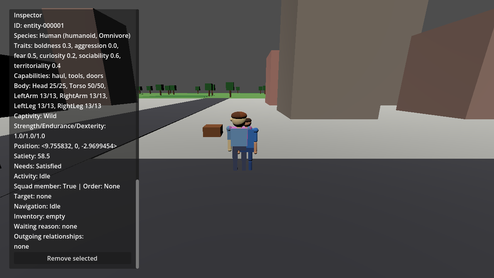

# Squad membership and orders — issue #312

Select a human NPC in the entity list and use **Add selected** or **Remove member**.
The single World-owned squad stores distinct stable human NPC IDs. The player,
creatures, dead entities, and missing entities cannot be added. Removing an entity
removes its membership and cancels its squad navigation.

Set map X/Z coordinates and press **Move to**, **Follow player**, or **Stop**.
Orders apply on the next running fixed tick. Repeated identical orders are no-ops;
invalid commands preserve the existing order and membership. Status reports
acceptance/rejection; the inspector shows membership, order, activity, authoritative
position, navigation, and waiting reason. Follow retargets after the player moves
more than one world unit, stops at 2 m and resumes beyond 3 m. Move-to arrival tolerance is 0.5 units. Failed navigation waits
without request churn; stop and issue a new movement order to retry.

Orders suspend autonomous hauling/roaming for members. Hunger retains priority;
movement resumes after eating. Stop holds movement except for hunger response.
Carried resources stay with the entity. With no order, normal autonomy resumes.

Schema **9** persists membership only. Orders/actions/navigation clear after a
successfully validated load. Invalid membership rejects before cancelling actions.
Versions 4–8 migrate with an empty squad; version 8 retains ownership and relations.
Health persistence remains deferred to existing issue #302.

Current follow clearance and the player-physics regression are documented in [FOLLOW_SPACING.md](FOLLOW_SPACING.md). The historical screenshots and results below describe the original #312 slice.

## Reproducible engine check

Run the README's restore/build/tests, then:

```powershell
dotnet test tests/Simulation.Tests/Simulation.Tests.csproj --configuration Release --no-restore --filter FullyQualifiedName~SquadTests
dotnet build game/UnnamedProject2026.csproj --configuration Debug --no-restore
& "C:\Developement\Godot\Godot_v4.7.2-stable_mono_win64\Godot_v4.7.2-stable_mono_win64.exe" --path game --headless -- --validate-squad
```

Godot loads the Debug assembly. The opt-in scenario starts seed 42 with profile
`Squad validation`, selects two NPCs, and invokes actual UI button signals.
It advances fixed ticks across real physics frames with the production navigation
mesh/adapter. Both members reach (4, 0, 3), follow to (7, 0, -3) then (10, 0, -3),
stop and hold positions, and restore membership with no orders. Inspector state is
asserted before/after load. The snapshot is in memory; the disk save slot is untouched.
Success logs `SQUAD VALIDATION PASSED`; failure logs an exception and exits 1.
Check `user://logs/godot.log` if the Windows GUI executable does not forward output.

For rendered screenshots, omit `--headless` and add
`--squad-screenshot=<absolute path to squad-validation.png>` after `--`.
The scenario saves controls there and `squad-inspector.png` beside it.

## Recorded results — 2026-10-03

- SDK 10.0.401; Godot 4.7.2 stable Mono official `ed1daf0bf`.
- Focused and full tests pass; final counts are in the PR. Coverage includes atomic
  rejection, repetition, hunger preemption/resumption, cancellation, unreachable
  recovery, snapshot validation, and schema 4–8 migration.
- Release solution/Debug game builds pass with two existing EntityView CS8604
  warnings. Local restore reports NU1900 because NuGet vulnerability data could
  not be fetched; audit freshness is unverified locally.
- Headless and rendered scenarios pass with the explicit marker in the engine log.
  Rendering uses OpenGL 3.3 compatibility on AMD Radeon RX 6400.
- Two incorrect test/harness API references were corrected after initial build
  failures. Screenshot review found the long status line expanding the panel;
  status/inspector wrapping now preserves the existing panel width.
- This checks real navigation and UI handlers. Formations, polished controls,
  combat, and the full 1.0 integration gate (#322) remain outside this issue.



