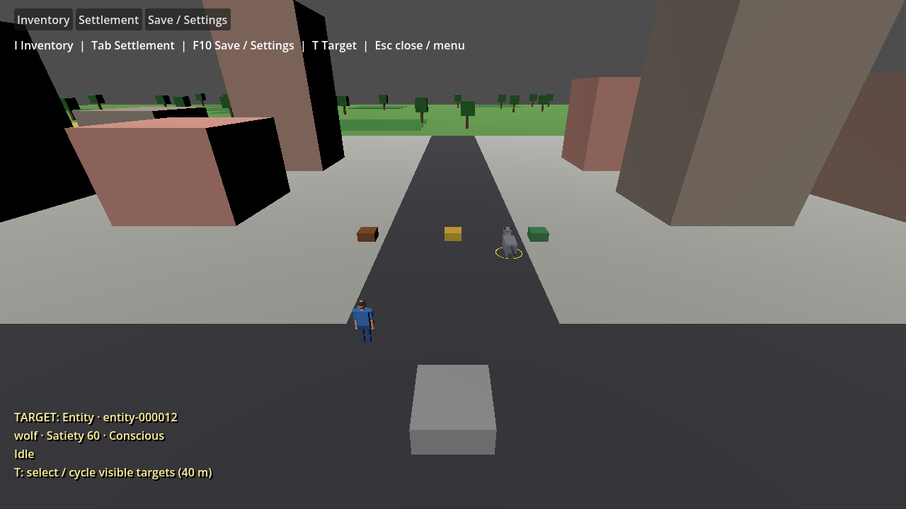
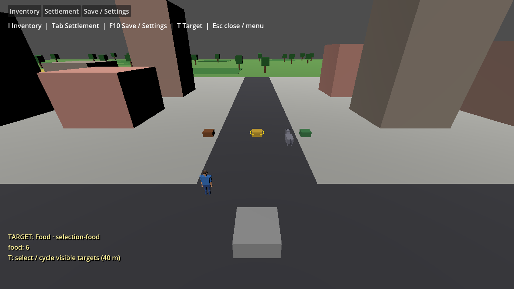

# Gameplay target selection

Issue [#388](https://github.com/jmart985/Unnamed-Project-2026/issues/388) fixes selection being available only in the Settlement menu. The user accepted a key to select/cycle targets so the existing mouse attack and look controls can remain available.

## Controls and behavior

During running gameplay with menus closed, press **T** to select a visible target within **40 m** of the player. The first selection favors the center of the camera view, then camera distance. Repeated presses cycle in stable target-type/ID order and wrap around. If nothing is eligible, selection clears and feedback says there are no visible targets. Holding the key does not repeatedly cycle.

Targets include human NPCs, creatures, food sources, resource piles and stockpiles. The player, hidden views and decorative buildings/trees/ground are not selectable. Issue #390 refines visibility to sample actual rendered mesh parts at several heights: a human's exposed head/body remains selectable when low storage covers the center. At least one sample must be in the camera frustum and unobstructed by existing scenery or other target mesh parts. Scenery is currently visual-only, so selection checks mesh bounds without adding physics bodies or changing navigation. This remains a finite sample/bounds approximation; transparent or irregular final-art geometry will need a later scoped picking policy.

A yellow ground ring marks the visible selection and a compact bottom-left HUD shows its type/ID and current species, satiety/condition/activity or resource counts. The HUD ignores mouse input. Counts and statuses are read from World, not copied into another inventory. A target that leaves view remains selected with an “out of view” label and its ring hidden; the next key press selects from the current visible set. Removal, reset and successful load clear stale references. Selection is transient and is not saved.

Selected entities are the same selection used by Settlement inspection, squad membership, schedules, greeting and debug navigation. Selecting a resource clears the entity target, so entity actions cannot accidentally address the previously selected NPC. Selection never opens a menu, attacks, consumes resources or changes the simulation clock. Menus, creation and paused gameplay suppress target cycling; menu feedback and the ring are hidden while a screen is open.

The target key is configurable in **Save / Settings → Controls → Cycle target**, including an optional controller button. Defaults are WASD movement, Space jump, E tap to collect / hold to use carried food, F greet the selected entity, I inventory, Tab settlement, T cycle target, F10/Escape settings and mouse left/right attacks. Existing saved bindings, including G for greeting, are preserved by settings migration; see [Player menu preferences](PLAYER_MENUS.md). Issue #390 connects targeted strikes, pickup/use and visible greeting responses; see [gameplay refinement](GAMEPLAY_REFINEMENT.md). Drop, map, sprint, dodge and abilities remain outside these slices.

## Reproduction and validation

Use the pinned README restore/build/test commands, then:

```powershell
dotnet build game/UnnamedProject2026.csproj --configuration Debug --no-restore
& '<Godot .NET executable>' --path game --headless -- --validate-selection
& '<Godot .NET executable>' --path game -- --validate-selection
```

Wait for the process to exit and require exit 0 plus `SELECTION VALIDATION PASSED` in the Godot log. On Windows use `Start-Process -Wait -PassThru` to obtain the actual GUI executable's exit code. The scenario dispatches real viewport input and checks five target kinds, complete cycling/wraparound, player/hidden-view exclusion, scenery obstruction, range/frustum filtering, key echo, menu/creation/pause isolation, shared inspection, live quantities, entity/resource removal, no-target recovery, reset/load cleanup, version-1 migration with T already assigned, version-2 persistence/reload, invalid/conflicting bindings, real rebound targeting and retained mouse attack/look. Save/preferences use separate `selection-validation-*.json` files; user settings and the normal save slot are untouched.

Rendered validation writes intentional screenshots under `docs/evidence/world-selection/`.

Actual validation on 2026-10-03: restore, Release solution build and Debug game build succeeded; all 541 domain tests passed. Selection validation passed headless and rendered. Headless menu, first-game, squad and schedule regressions passed. Inspected screenshots show live food and creature targets with menus closed. Existing EntityView CS8604 warnings and unavailable NuGet audit NU1900 remain; no separate formatter/linter or packaging workflow is configured.



